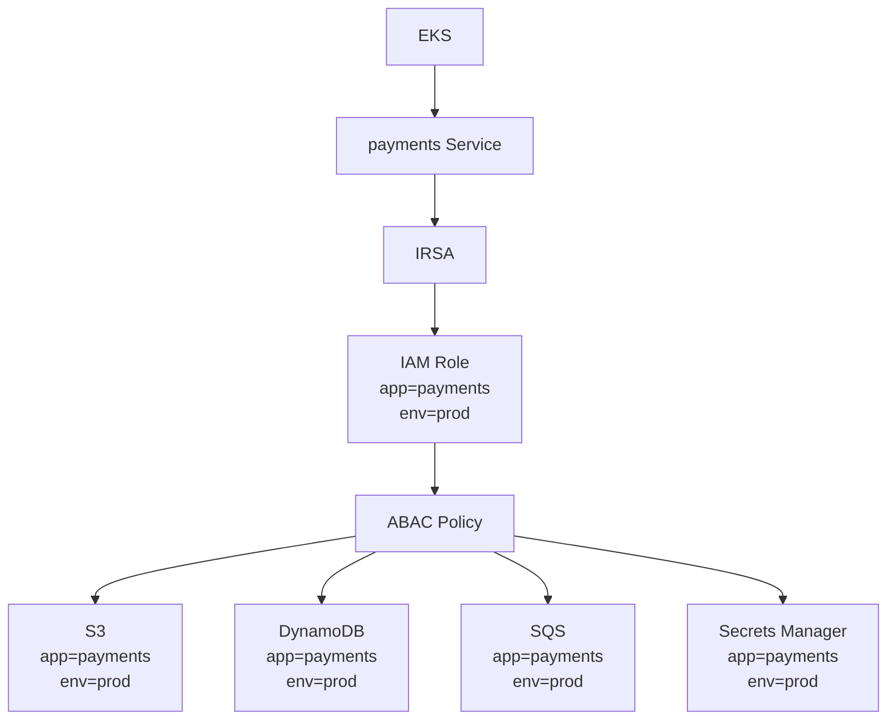

# ABAC — EKS + IRSA Example

## ABAC in an EKS environment

As an EKS environment grows, IAM policies can become harder to maintain.

With a traditional approach, an IAM Role may need permissions for each AWS resource individually:

- S3 bucket
- DynamoDB table
- SQS queue
- Secrets Manager secret

As new resources are created, policies may need to be updated with additional ARNs and permissions.

### ABAC approach

**Attribute-Based Access Control (ABAC)** uses attributes — in AWS, commonly tags — to define access.

Instead of asking:

> Which specific resources can this IAM Role access?

The policy can ask:

> Does the resource have the same attributes as the IAM principal?

For our `payments` service, the IAM Role can be tagged:

```text
app = payments
env = prod
```

The AWS resources can use the same tags:

```text
S3          → app=payments, env=prod
DynamoDB    → app=payments, env=prod
SQS         → app=payments, env=prod
Secrets     → app=payments, env=prod
```

If the attributes match, the policy allows access.

## EKS + IRSA



### Traditional IAM vs ABAC

```text
Traditional IAM

EKS → Service → IRSA → IAM Role
                         ├── Policy → S3 bucket
                         ├── Policy → DynamoDB table
                         ├── Policy → SQS queue
                         └── Policy → Secret

New resource → potentially more policy/ARN management
```

```text
ABAC

EKS → Service → IRSA → IAM Role
                         │
                         │ app=payments
                         │ env=prod
                         ▼
                    ABAC Policy
                         │
            ┌────────────┼────────────┐
            ▼            ▼            ▼
           S3          SQS        DynamoDB      Secrets
       app=payments  app=payments  app=payments  app=payments
       env=prod      env=prod      env=prod      env=prod
```

## Simple ABAC Policy

The following policy illustrates the concept: allow access when the resource tags match the principal tags.

```json
{
  "Version": "2012-10-17",
  "Statement": [
    {
      "Effect": "Allow",
      "Action": [
        "s3:*",
        "sqs:*",
        "dynamodb:*",
        "secretsmanager:*"
      ],
      "Resource": "*",
      "Condition": {
        "StringEquals": {
          "aws:ResourceTag/app": "${aws:PrincipalTag/app}",
          "aws:ResourceTag/env": "${aws:PrincipalTag/env}"
        }
      }
    }
  ]
}
```

### How it works

The IAM Role has:

```text
app = payments
env = prod
```

A resource with:

```text
app = payments
env = prod
```

matches the policy and can be accessed.

A resource with:

```text
app = orders
env = prod
```

does not match and access is denied by this statement.

## Key takeaway

> **ABAC = access based on matching attributes/tags.**

For EKS + IRSA, IRSA establishes **which IAM Role the workload uses**. ABAC can then help define **which AWS resources that role can access**, based on attributes such as `app`, `team`, or `environment`.

ABAC does not remove IAM limits automatically. The relevant AWS service must support the required condition keys, and tagging must be controlled properly.
